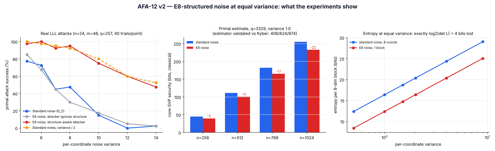

# AFA-12 v2 — Lattice-Structured Noise in LWE: A Negative Result

**Version:** 2.0 (supersedes v1.0, which contained errors — see Erratum)
**Date:** 2026-10-24
**Author:** Adrian Calabro
**Status:** Closed research question, with reproducible code and data

---

## Summary

AFA-12 asked whether sampling LWE noise from the E8 lattice (densest sphere packing in dimension 8) instead of an independent per-coordinate distribution could lower decryption failures or improve security. **It cannot.** With a correct sampler, a validated estimator and real lattice attacks, all three hypotheses are refuted:

| Hypothesis | v1 claim | v2 verdict | Evidence |
|---|---|---|---|
| H1: lower failure rate | partial | **Refuted** — no effect | Decryption noise statistically indistinguishable at equal variance (KS test) |
| H2: hardness preserved | supported | **Refuted** — security lost | E8 noise behaves like standard noise with σ/√2: −17 bits at Kyber-768 size |
| H3: no exploitable structure | partial | **Refuted** — structure is exploitable | Structure-aware attacker succeeds as if variance were halved (real LLL attacks) |

**General statement.** If noise lies in a sublattice L ⊂ ℤᵏ of index D (blockwise), and q is coprime to D, then at equal per-coordinate variance:
- correctness is unchanged (only variance matters for the decryption noise), and
- security equals that of standard noise with standard deviation σ·D^(−1/k), because the attacker can intersect the attack lattice with Lᵇˡᵒᶜᵏˢ, raising its volume by D per block without changing the target vector. The same factor appears as an exact entropy loss of log₂D bits per block.

ℤᵏ itself (D = 1) is therefore optimal among integer lattices. For integral E8 (D = 16, k = 8) the factor is 1/√2.

---

## Erratum for v1.0

| Error in v1 | Consequence | Fix in v2 |
|---|---|---|
| E8 points were rounded with NumPy's round-half-to-even; the ~50% of E8 points with half-integer coordinates were all mapped to even vectors | The noise used in phases 2–4 was not E8 noise; the "100% parity bias" and odd marginals were partly an artifact | Exact sampler over the integral E8 lattice (Construction A), no rounding |
| Security estimator used a wrong success condition | Gave β≈212 for a Kyber-512-size instance (true ≈406) and was non-monotonic in σ | 2016 primal estimate, validated against Kyber: 406 / 624 / 874 vs published 406 / 623 / 873 |
| "Matched variance" was 1.29 vs 1.00 | Phase 2 comparison not fair | Exact variance calibration (both 1.0000) |
| Phase 4 conclusions were hard-coded text written before the data | Summary contradicted the measured third-order moments | All conclusions here are computed from saved outputs |
| Timing measured in Python/NumPy | Measures interpreter overhead, not a real side channel | Timing claims dropped |
| NIST parameter-scaling table (n ≥ 812 for Level 1) | Derived from the broken estimator; wrong | Removed |

---

## 1. Correct integral E8 noise

E8 has half-integer points, so integer LWE noise must use an integral copy:

L = { x ∈ ℤ⁸ : x mod 2 ∈ H₈ } = √2·E8, where H₈ is the extended Hamming [8,4,4] code (doubly even; the same code family that appears in Gates' Adinkra classification). det L = 16, minimum norm² = 4.

**Exact sampler** (`v2/e8_construction_a.py`): D_{L,s} is a mixture over the 16 Hamming cosets; given the coset, coordinates are independent draws from D_{2ℤ+cᵢ, s}. This is simple and could be implemented in constant time (unlike the Klein/Peikert sampler used in v1). Membership verified: 100% of 20,000 blocks lie in L.

### Entropy at equal variance (exact computation)

| Var/coord | Standard noise H (bits/8 coords) | E8 noise H (bits/block) | Loss |
|---|---|---|---|
| 0.5 | 12.378 | 8.392 | 3.986 |
| 1.0 | 16.377 | 12.377 | 4.000 |
| 1.5 | 18.717 | 14.717 | 4.000 |
| 2.0 | 20.377 | 16.377 | 4.000 |
| 4.0 | 24.377 | 20.377 | 4.000 |
| 9.0 | 29.056 | 25.056 | 4.000 |

Loss = log₂(det L) = 4 bits per block, 0.5 bit per coordinate (128 bits for n = 256). This is what the v1 "parity leak" was pointing at: x mod 2 is always a Hamming codeword, which fixes 4 of the 8 parity bits of every block.

---

## 2. H1 — decryption failure (re-run with correct samplers)

Model: w = ⟨e, r⟩ − ⟨s, e₁⟩ + e₂, n = 256, 200,000 samples per distribution, per-coordinate variance 1.0000 for both.

| Metric | Standard noise | E8 noise |
|---|---|---|
| var(w) (theory 513) | 511.02 | 512.99 |
| Excess kurtosis of w | +0.0168 | +0.0172 |
| P(\|w\| > 2 sd) | 4.39e-2 | 4.46e-2 |
| P(\|w\| > 3 sd) | 3.04e-3 | 2.90e-3 |
| P(\|w\| > 4 sd) | 6.50e-5 | 6.00e-5 |
| Two-sample KS statistic | 0.00195 (5% critical value 0.00430): **indistinguishable** | |

w sums hundreds of products, so by the central limit theorem only the variance survives; the 8-dimensional shape of the noise is averaged away. E8's packing optimality does not translate into fewer failures when used as noise.

---

## 3. H2 — security (validated estimator)

**Model:** 2016 primal uSVP estimate (as in the Kyber specification). For d = n+m+1 and volume q^m, BKZ-β succeeds iff σ√β ≤ δ(β)^(2β−d−1)·vol^(1/d). Core-SVP cost is 0.292β classical. For E8 noise the attacker's lattice volume is multiplied by 16^((n+m)/8).

**Validation:**

| Scheme | β (ours) | β (published) |
|---|---|---|
| Kyber-512 | 406 | 406 |
| Kyber-768 | 624 | 623 |
| Kyber-1024 | 874 | 873 |

**Equal variance (1.0), q = 3329:**

| n | β standard | β E8 | Bits standard | Bits E8 | Equivalent σ for standard noise |
|---|---|---|---|---|---|
| 256 | 153 | 135 | 44.7 | 39.4 | 0.706 |
| 512 | 382 | 345 | 111.5 | 100.7 | 0.707 |
| 768 | 624 | 567 | 182.2 | 165.6 | 0.705 |
| 1024 | 874 | 797 | 255.2 | 232.7 | 0.704 |

The equivalent σ is 1/√2 ≈ 0.707 in every case. Recovering Kyber-768's β = 624 with E8 noise requires variance 2.0. That doubles the variance of every noise term and raises the decryption noise accordingly: E8 noise is strictly worse.

---

## 4. H3 — real attacks (structure is exploitable)

Primal Kannan-embedding attack with our own LLL (`v2/real_attack.py`), n = 24, m = 48, q = 257, uniform secret, 40 independent instances per point. Success means the reduced basis contains ±(e, 1). The structure-aware lattice is 2·Λ₁ + q·Λ₂ (Λ₁ = embedding lattice, Λ₂ = L^(m/8) × ℤ), valid because gcd(2, q) = 1. Its determinant was checked to equal vol(Λ₁)·2^(m/2) exactly.

| Var/coord | Standard | E8, attacker ignores structure | **E8, structure-aware** | Standard, var/2 |
|---|---|---|---|---|
| 5 | 78% | 85% | 98% | 100% |
| 6 | 72% | 68% | 100% | 98% |
| 7 | 45% | 45% | 92% | 95% |
| 8 | 48% | 30% | 95% | 92% |
| 10 | 15% | 18% | 75% | 80% |
| 12 | 0% | 5% | 60% | 60% |
| 14 | 2% | 2% | 48% | 52% |

The structure-aware attack on E8 noise tracks the standard-noise attack at half the variance, as predicted. An attacker who ignores the structure sees no difference, which is why the weakness is easy to miss.



---

## 5. Limitations

- Real attacks use LLL in small dimension (d = 49); cryptographic-size claims rest on the 2016 estimate, which is the standard model but not a proof. Dual and hybrid attacks were not evaluated; they can only make the structured case weaker or equal.
- Our LLL is a floating-point implementation; one numerical warning appeared across ~1,100 attack runs and at most affects a single trial.
- The volume argument requires q coprime to det L (true for q = 3329, 257 and det = 16).

---

## 6. Where E8 does help

The useful place for E8 in LWE-based encryption is the **message encoding**, not the noise: encoding 8 message bits per 8 coefficients as an E8 point increases the minimum distance between messages and lowers the failure rate (or allows smaller ciphertexts). This is an active line of prior work, e.g. *Error Correction for FrodoKEM Using the Gosset Lattice* (arXiv:2110.01740) and later lattice-code papers for Kyber-type schemes. Possible open contributions: a constant-time E8 decoder measured in C, concrete ML-KEM ciphertext savings at failure rate 2⁻¹³⁹, and a comparison of E8, Leech and Barnes–Wall codes under one framework.

---

## 7. Reproduction (`v2/`, Python 3 + NumPy + Matplotlib)

```bash
python e8_construction_a.py          # exact sampler, membership, entropy table
python failure_recheck.py            # H1
python estimator.py                  # validation vs Kyber + H2 table (~15 s)
python real_attack.py 24 48 257 40 2 5,6,7,8,10,12,14   # H3 (~20 min, 2 cores)
python make_figure.py                # afa12_v2_results.png
```

## References

1. Regev (2005). On lattices, learning with errors, random linear codes, and cryptography. STOC.
2. Alkim, Ducas, Pöppelmann, Schwabe (2016). Post-quantum key exchange — a new hope. USENIX Security (2016 primal estimate).
3. Bos et al. / Avanzi et al. CRYSTALS-Kyber specification, round 3; NIST FIPS 203 (2024).
4. Conway & Sloane. Sphere Packings, Lattices and Groups (Construction A, E8).
5. Viazovska (2016). The sphere packing problem in dimension 8. Annals of Mathematics.
6. Doran, Faux, Gates, Hübsch, Iga, Landweber, Miller. Relating doubly-even error-correcting codes, graphs, and irreducible representations of N-extended supersymmetry.
7. Saliba, Luzzi, Ling. Error Correction for FrodoKEM Using the Gosset Lattice. arXiv:2110.01740.

---
*AFA-12 is an open research framework. Contact: calabroadrian@gmail.com*
